![Artboard][NuggetLogo]

# GoldenNugget
[](LICENSE)
[](https://github.com/GoldenNugget-Team/GoldenNugget/actions/workflows/tests.yml)

[Download](https://github.com/GoldenNugget-Team/GoldenNugget/releases/latest) · [Wiki](https://github.com/GoldenNugget-Team/GoldenNugget/wiki) · [Report a bug](https://github.com/GoldenNugget-Team/GoldenNugget/issues/new/choose) · [Discussions](https://github.com/GoldenNugget-Team/GoldenNugget/discussions)

> [!WARNING]
> **Back up your device before applying tweaks.** GoldenNugget can cause data loss, boot loops, or other unexpected device problems. Use this project at your own risk; the authors are not responsible for damage to your device or data. See the [full disclaimer](docs/DISCLAIMER.md).

Unlock your device's full potential, with iOS 27 support!

Customize your device with animated wallpapers, disable pesky daemons, and more!

Make sure you have installed the [requirements](#requirements) if you are on Windows or Linux.

## Quick Start

For a packaged app, download the archive for your platform from the
[latest release](https://github.com/GoldenNugget-Team/GoldenNugget/releases/latest).
See the [installation guide](https://github.com/GoldenNugget-Team/GoldenNugget/wiki/Installation-and-first-launch) for setup help.

To run from source, download or clone this repository and open a terminal in its folder.

1. Install the device connection tools listed in [Requirements](#requirements).
2. Create and activate a virtual environment:

```bash
python -m venv .venv
# Windows PowerShell
.\.venv\Scripts\Activate.ps1
# macOS/Linux
source .venv/bin/activate
```

3. Install the pinned dependencies and start GoldenNugget:

```bash
python -m pip install -r requirements.txt
python main_app.py
```

Make a full device backup before applying tweaks. Use `python main_app.py --test-mode`
to open the interface with mock devices and no iPhone connected.

## Compatibility

| Component | Supported | Notes |
| --- | --- | --- |
| iOS | 26.2–27.x | Older versions are blocked by the app. |
| Windows | Apple Devices or iTunes | Install one before connecting an iPhone. |
| Linux | `usbmuxd` and `libimobiledevice` | Both are required for USB access. |
| Python | 3.10+ | Use the pinned packages in `requirements.txt`. |

## Discord server
Need support? Join our [Discord Server][server].

## On-device mobile version
[GoldenNugget Mobile][mobile] runs on your device without a computer.

## Features
<details>
<summary>iOS 26.2 - 27.0+</summary>

- PosterBoard: Animated wallpapers and descriptors.
  - Community wallpapers can be found [here][WallpapersWebsite] or [here][caplayground]
  - Customizing community-made wallpapers via batter files
  - Device-Specific wallpapers in MercuryPoster can be installed
  - See documentation on the structure of tendies and batter files in [documentation.md](documentation.md)
- Templates: Custom Operations and file editing
  - See documentation on the structure of batter files in [documentation.md](documentation.md)
- Status Bar
  - Live preview of the Lock Screen and Home Screen status bar before applying
  - iOS 26 and below: full override set
    - Change carrier name
    - Change secondary carrier name
    - Enable/Disable the primary or secondary carriers
    - Change the number of WiFi/Cellular bars
    - Change the battery capacity
    - Change battery display detail
    - Change time text
    - Change date text (iPad only)
    - Change breadcrumb text
    - Show numeric WiFi/Cellular strength
    - Hide or show many icons in the status bar
  - iOS 27 and above: cellular entry only (the rest of the overrides have no
    equivalent in the new status bar format and are hidden on that page)
    - Change primary and secondary carrier name
    - Change primary and secondary service badge
    - Change primary and secondary signal bars
    - Not yet verified on physical hardware, only on the iOS 27 simulator
- Springboard Options
  - Set Lock Screen Footnote
  - Set Lock Screen Idle Auto-Lock Time
  - Disable Lock After Respring
  - Disable Screen Dimming While Charging
  - Disable Low Battery Alerts
  - Hide AC Power on Lock Screen
  - Show Supervision Text on Lock Screen
  - Show Dynamic Island in Screenshots
  - Enable AirPlay support for Stage Manager
  - Show Red/Green Authentication Line on Lock Screen (See [this issue](https://github.com/leminlimez/Nugget/issues/656) for what it looks like)
  - Disable Floating Tab Bar on iPads
  - Disable AirDrop Time Limit for Everyone Option
  - Disable Breadcrumbs
  - Disable Dynamic Island
  - Disable Icon Parallax
  - Hide Search Button on Home Screen
  - Allow pairing with any watchOS version (iPad only)
- Internal Options
  - Build Version in Status Bar
  - Force Right to Left / Left to Right
  - Show Hidden Icons on Home Screen
  - iMessage, Continuity and FaceTime Debugging
  - Show Accessory Developer Settings
  - Disable Clock Icon Seconds Hand
  - Disable Spotlight Searching in Websites
  - Show Hardware Button Hints in Screenshots
  - Vibrate on Raise-to-Wake
  - App Store Debug Gesture
  - Notes App Debug Mode
  - Show Touches With Debug Info
  - Hide Respring Icon
  - Play Sound on Paste
  - Show Notifications for System Pastes
- Liquid Glass (iOS 26.0+): 98 options, searchable in the app
  - Disable or tone down Liquid Glass: Solarium fallback (iOS 26 only), linked-on, hardware and opt-out checks
  - Turn off specular highlights, refraction, HDR and shadows for the Dock, folders, widgets and Lock Screen clock
  - Flat icons everywhere
  - iOS 27: experimental glass flags (Calistoga, floating and stacked-image effects, debug overlays)
- Disable Daemons (with a one-tap Recommended set):
  - System services: thermalmonitord, OTA updates, UsageTrackingAgent, Game Center, Screen Time Agent, ATWAKEUP, Tips, VPN icon, Chinese WLAN service, HealthKit, AirPrint, Assistive Touch, iCloud, Internet Tethering (Personal Hotspot), Passbook, Spotlight, Voice Control, NanoTimeKit, Apple Ads, News, Family Sharing, Video Subscriptions, Web Bookmarks, Apple Watch (Nano) services, Siri backend services, Wi-Fi logging, Maps (geod), Safari Suggestions, Reminders, AirPlay, GameKit, Sidecar, Speech Recognition, Translate, Mock Location, DeviceCheck
  - Analytics & diagnostics: crash reporting, Wi-Fi, system, audio, ecosystem, call and media analytics, CoreDuet, Insight, Metrics, symptom, statistical and wireless diagnostics, Duet heuristics, decisiond, triald, sociald
- Icon Themes: custom Home Screen icons and labels as WebClips, plus downloadable icon packs
- Passcode Themes: custom passcode keypads from `.passthm` packages, written over USB/Wi-Fi with [AirLift] (no reboot)
- Presets: save, switch, export and import whole tweak setups (`.gnpreset`); see [Portable presets](docs/PORTABLE_AND_DIAGNOSTICS.md)
- Share a preset as a QR code or a one-line code, and import someone else's setup from a screenshot or pasted text
- Preset catalog: browse community presets reviewed by the team, check their risk, preview and import them, or submit your own
- Risk check before every apply: a Low / Medium / High verdict with reasons, and an explicit confirmation for high-risk setups
- Preview on iPhone: see the Lock Screen and Home Screen with your tweaks, drawn for your model, before applying (also for presets and shared codes)
- Command line: everything above is scriptable through `python nugget_cli.py --help`, with `--json` output and `--dry-run` applies
</details>

## Screenshots

<details>
<summary>Open the English interface screenshots</summary>

<table>
<tr>
<td>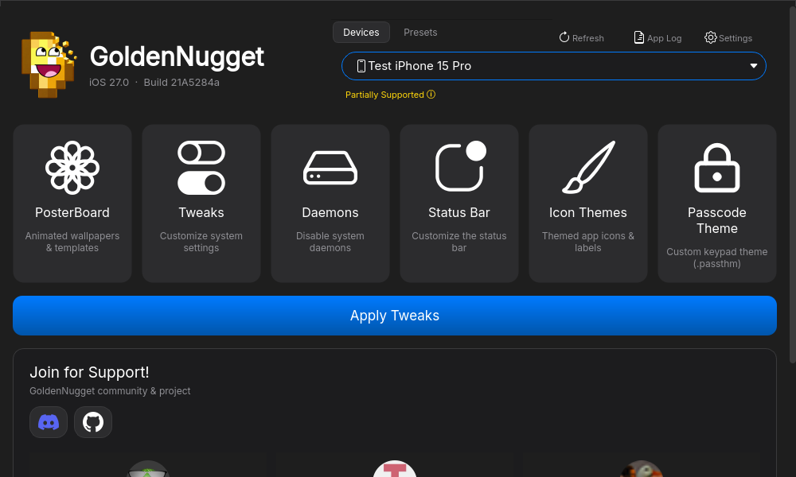</td>
<td>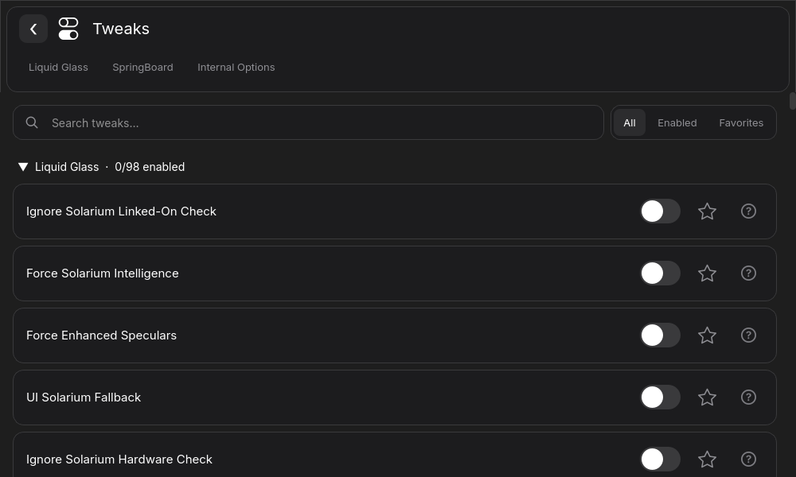</td>
<td>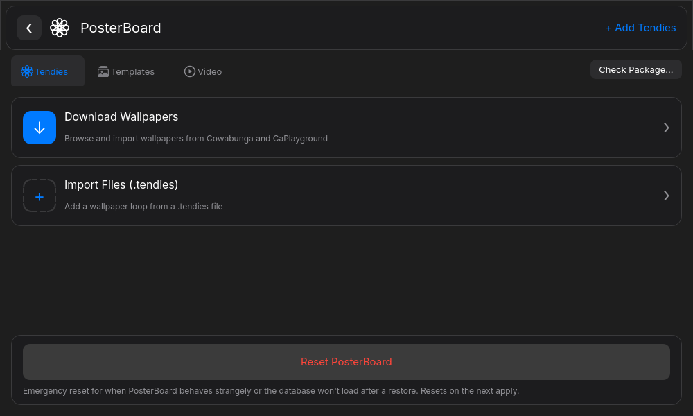</td>
</tr>
<tr>
<td>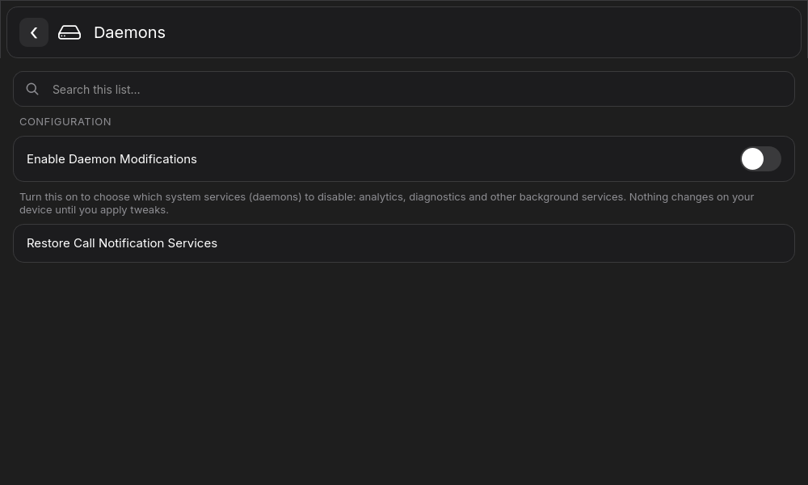</td>
<td>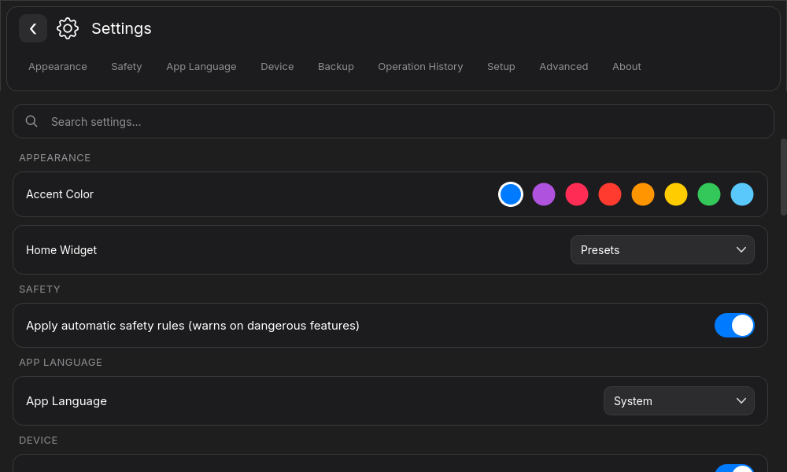</td>
<td>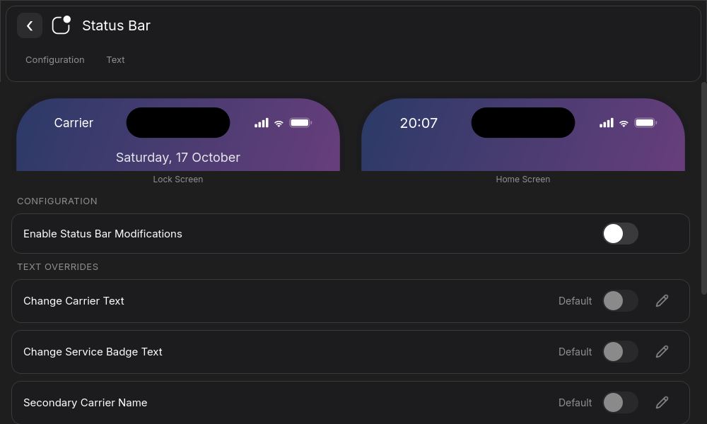</td>
</tr>
<tr>
<td>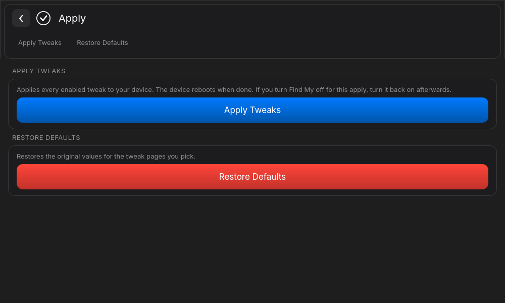</td>
<td>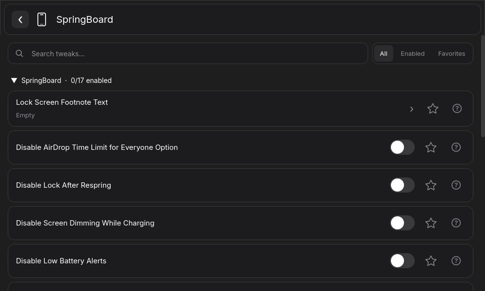</td>
<td>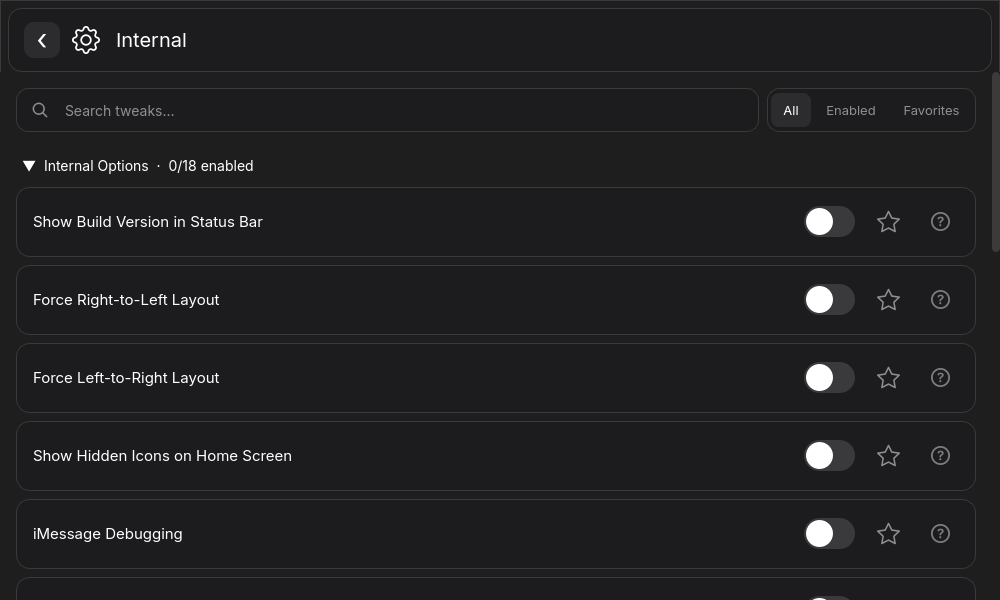</td>
</tr>
<tr>
<td>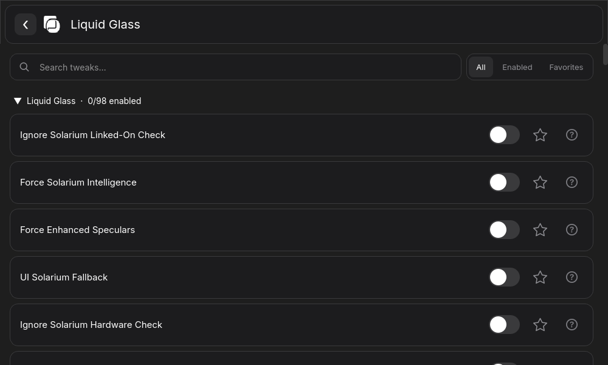</td>
<td>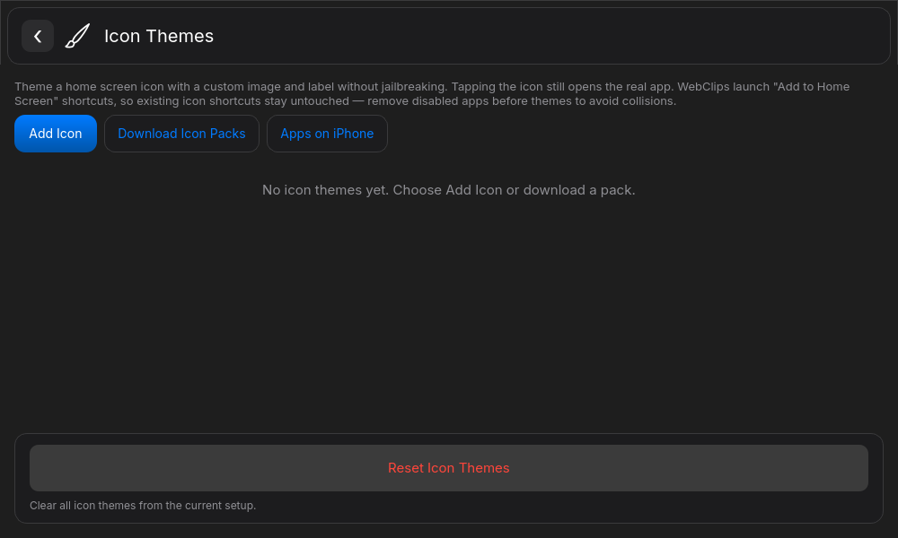</td>
<td>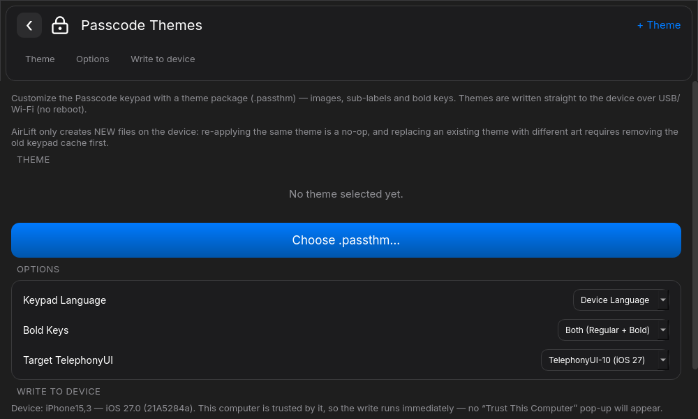</td>
</tr>
</table>

</details>

## Contributors 

<div align="center">

**Thanks to everyone who contributes to the project!** 🎉

<a href="https://github.com/GoldenNugget-Team/GoldenNugget/graphs/contributors">
  
</a>

Want to see your name here? Open a [Pull Request](https://github.com/GoldenNugget-Team/GoldenNugget/pulls)!

</div>

## Star History

<a href="https://www.star-history.com/?type=date&repos=GoldenNugget-Team%2FGoldenNugget">
 <picture>
   <source media="(prefers-color-scheme: dark)" srcset="https://api.star-history.com/chart?repos=GoldenNugget-Team/GoldenNugget&type=date&theme=dark&legend=top-left&sealed_token=3Suw7Y0hFqwuBPijtmeM2A7pzK2ZCvEPoousYMJzOVFnPza-Aq5SzgNnEcgveIpQsBLEOL2QRtxwZbmaxn_S_3Lf9l0jINrMfRWkjFWGo3dVYCrFRpN6dA" />
   <source media="(prefers-color-scheme: light)" srcset="https://api.star-history.com/chart?repos=GoldenNugget-Team/GoldenNugget&type=date&legend=top-left&sealed_token=3Suw7Y0hFqwuBPijtmeM2A7pzK2ZCvEPoousYMJzOVFnPza-Aq5SzgNnEcgveIpQsBLEOL2QRtxwZbmaxn_S_3Lf9l0jINrMfRWkjFWGo3dVYCrFRpN6dA" />
   
 </picture>
</a>

<div align="center">
<br>We think you can star this repo if you think this is a good project.</br>
</div>

> [!NOTE]
> ## Mobilegestalt
> Don't even ask me for it. It will be NEVER implemented again. 

## Requirements:
<details>
<summary>Windows</summary>
  
  - Either the [Apple Devices (from Microsoft Store)][AppleDevices] App or [iTunes (from Apple website)][iTunes]
</details>

<details>
<summary>Linux</summary>

  - [usbmuxd][usbmuxdGitHub]
  - [libimobiledevice][libimobiledeviceGitHub]

  If they are missing, GoldenNugget offers to install them (Arch, Debian/Ubuntu, Fedora, openSUSE, Alpine and Void families); the system asks for your administrator password through polkit, so the app never sees it.
</details>

<details>
<summary>For Running Python</summary>

  - [pymobiledevice3][pymobiledevice3GitHub]
  - [PySide6][PySide6Doc] (PySide6-Essentials on non-Linux, selected automatically)
  - [ffmpeg-python](https://pypi.org/project/ffmpeg-python/) (video wallpapers)
  - [opencv-python](https://pypi.org/project/opencv-python/) (video wallpapers)
  - Python 3.10 or newer
</details>

> All pinned deps are in `requirements.txt` (incl. PyInstaller for building).

## Documentation

- [Wiki](https://github.com/GoldenNugget-Team/GoldenNugget/wiki): installation, tweaks, presets, wallpapers and troubleshooting.
- [Portable presets and diagnostics](docs/PORTABLE_AND_DIAGNOSTICS.md): `.gnpreset` files, diagnostic archives, JSON CLI output and offline wallpaper checks.
- [Architecture](docs/ARCHITECTURE.md): device connections, background operations and backup/restore internals.
- [Contributing](CONTRIBUTING.md): contribution guidelines and offline checks.

## Building

Follow [Quick Start](#quick-start) to install the dependencies first.
The generated `src/qt/mainwindow_ui.py` is committed; no Designer UI generation
step is required for the current interface.

When changing Qt resources, regenerate the resource module:
```py
pyside6-rcc --compress-algo zlib src/qt/resources.qrc -o src/qt/resources_rc.py
```

Translations live in the [gNugget-i18n repository][i18n] and are synced into
`src/qt/translations/` automatically, so do not edit the `Nugget_*.ts` files here.
See [I18N_SETUP.md](I18N_SETUP.md) for the sync, the local Russian catalog and the
pitfalls of regenerating catalogs with `pyside6-lupdate`.

Build the application for your current platform:

```bash
python compile.py
```

Build output is written to `dist/`.

## Contributing and forking

See [CONTRIBUTING.md](CONTRIBUTING.md) for contributions and [FORKING.md](FORKING.md) for forks.

## Credits
- [awesomenull] Lead developer
- [Wind0ws11Aero] for helping with development a lot.
- [kik4311] Co-developer
- Translations crowdsourced using [gNugget-i18n repository][i18n]
- [LeminLimez] for creating Nugget.
- [0xjonhnnydev] for [AirLift]
- [LEGACY] Old translations were crowdsourced using [Nugget POEditor][POEditorJoin]. Thank you everyone who assisted in the translation effort!
- [PosterRestore][PosterRestoreDiscord] for their help with PosterBoard
  - Special thanks to [dootskyre][dootskyreX], [Middo][MiddoX], [dulark][dularkGitHub], forcequitOS, and pingubow for their work on nugget. It would not have been possible without them!
  - Thanks to [Snoolie for aar handling][python-aar-stuffGitHub]!
- [iTechExpert][iTechExpertTwitter] for various Springboard/Internal Options
- [Mikasa-san][Mikasa-sanGitHub] for [Quiet Daemon][QuietDaemonGitHub]
- [pymobiledevice3][pymobiledevice3GitHub] for restoring and device algorithms.
- [PySide6][PySide6Doc] for the GUI library.

[caplayground]: https://caplayground.vercel.app/wallpapers
[i18n]: https://github.com/awesomenull-dev/gNugget-i18n
[NuggetLogo]: https://github.com/GoldenNugget-Team/GoldenNugget/blob/main/src/qt/credits/small_nugget.png
[LeminLimez]: https://github.com/leminlimez
[CowabungaLite]: https://github.com/leminlimez/CowabungaLite
[WallpapersWebsite]: https://cowabun.ga/wallpapers
[AppleDevices]: https://apps.microsoft.com/detail/9np83lwlpz9k
[iTunes]: https://support.apple.com/en-us/106372
[usbmuxdGitHub]: https://github.com/libimobiledevice/usbmuxd
[libimobiledeviceGitHub]: https://github.com/libimobiledevice/libimobiledevice
[ShortcutsApp]: https://apps.apple.com/us/app/shortcuts/id915249334
[MobilegestaltShortcut]: https://www.icloud.com/shortcuts/66bd3c822a0145b98d46cd1c9077e6e5
[ReadMoreGist]: https://gist.github.com/leminlimez/c602c067349140fe979410ef69d39c28
[Wind0ws11Aero]: https://github.com/Wind0ws11Aero
[POEditorJoin]: https://poeditor.com/join/project/UTqpVSE2UD
[JJTechGitHub]: https://github.com/JJTech0130
[TrollStoreGitHub]: https://github.com/JJTech0130/TrollRestore
[PosterRestoreDiscord]: https://discord.gg/gWtzTVhMvh
[dootskyreX]: https://x.com/dootskyre
[MiddoX]: https://x.com/MWRevamped
[dularkGitHub]: https://github.com/dularkian
[SerStarsX]: https://x.com/SerStars_lol
[disfordottieX]: https://x.com/disfordottie
[Mikasa-sanGitHub]: https://github.com/Mikasa-san
[QuietDaemonGitHub]: https://github.com/Mikasa-san/QuietDaemon
[sneakyf1shyGitHub]: https://github.com/f1shy-dev
[lrdsnowGitHub]: https://github.com/Lrdsnow
[EUEnablerGitHub]: https://github.com/Lrdsnow/EUEnabler
[pymobiledevice3GitHub]: https://github.com/doronz88/pymobiledevice3
[PySide6Doc]: https://doc.qt.io/qtforpython-6/
[python-aar-stuffGitHub]: https://github.com/0xilis/python-aar-stuff
[AIEligibilityGist]: https://gist.github.com/f1shy-dev/23b4a78dc283edd30ae2b2e6429129b5
[bl_sbxGitHub]: https://github.com/khanhduytran0/bl_sbx/tree/main
[DuyGitHub]: https://github.com/khanhduytran0
[HuyTwitter]: https://x.com/Little_34306
[iTechExpertTwitter]: https://twitter.com/iTechExpert21
[server]: https://discord.gg/Rm6r4zeE3y
[0xjonhnnydev]: https://github.com/0xjohnnydev
[awesomenull]: https://github.com/awesomenull-dev
[kik4311]: https://github.com/kik4311
[AirLift]: https://github.com/0xjohnnydev/airlift
[mobile]: https://github.com/GoldenNugget-Team/GoldenNugget-mobile
